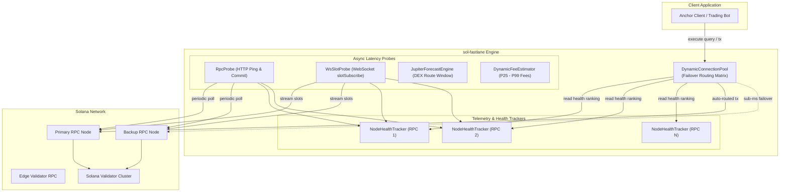

# sol-fastlane: Systems Architecture & Engine Design

This document outlines the low-latency design, mathematical scoring models, and runtime concurrency architecture of `sol-fastlane`.

---

## 1. Design Principles

`sol-fastlane` is engineered for high-frequency trading bots, DeFi protocols, and automated execution engines where transaction landing certainty and microsecond routing precision directly dictate PnL.

- **Zero-Allocation Hot Paths:** Critical latency polling and failover dispatch minimize heap allocations on query cycles.
- **Lock-Free / Low-Contention State:** Internal telemetry uses cache-line aligned atomic integers (`AtomicU64`) and fine-grained `parking_lot::RwLock` to eliminate thread starvation.
- **Fail-Secure by Default:** If all RPC endpoints experience cluster-wide partitioning, the engine halts unsafe execution rather than returning unverified dummy data.

---

## 2. High-Level Architecture

---

## 3. Mathematical Health Scoring Model

Each node is tracked across a rolling ring buffer of historical samples ($W = 30$). The health scoring function outputs a continuous score $S \in [0.0, 100.0]$:

$$S = \max\left(0, \min\left(100, S_{\text{latency}} + S_{\text{lag}} + S_{\text{reliability}}\right)\right) \times P_{\text{consecutive}}$$

### 3.1 Latency Component ($S_{\text{latency}} \le 40$ pts)
Calculated from average round-trip time ($\bar{L}_{\text{rtt}}$):

$$S_{\text{latency}} = \begin{cases} 
40.0 & \text{if } \bar{L}_{\text{rtt}} \le 50\,\text{ms} \\
40.0 \times \left(1.0 - \frac{\bar{L}_{\text{rtt}} - 50}{450}\right) & \text{if } 50 < \bar{L}_{\text{rtt}} \le 500\,\text{ms} \\
0.0 & \text{if } \bar{L}_{\text{rtt}} > 500\,\text{ms}
\end{cases}$$

### 3.2 Slot Lag Component ($S_{\text{lag}} \le 35$ pts)
Slot lag ($\delta_{\text{slot}}$) represents the gap between the node's processed slot and the cluster tip ($S_{\text{tip}} - S_{\text{node}}$):

$$S_{\text{lag}} = \begin{cases}
35.0 & \text{if } \delta_{\text{slot}} = 0 \\
28.0 & \text{if } \delta_{\text{slot}} = 1 \\
20.0 & \text{if } \delta_{\text{slot}} = 2 \\
12.0 & \text{if } \delta_{\text{slot}} = 3 \\
5.0 & \text{if } \delta_{\text{slot}} = 4 \\
0.0 & \text{if } \delta_{\text{slot}} \ge 5
\end{cases}$$

### 3.3 Reliability & Packet Loss ($S_{\text{reliability}} \le 25$ pts)
Given error rate $E = \frac{N_{\text{failed}}}{N_{\text{total}}}$:

$$S_{\text{reliability}} = 25.0 \times (1.0 - E)$$

### 3.4 Consecutive Error Penalty Multiplier ($P_{\text{consecutive}}$)
- 0 errors: $P = 1.0$
- 1 or 2 errors: $P = 0.7$
- $\ge 3$ consecutive errors: $S$ is hard-clamped to $\le 10.0$ and node marked `is_healthy = false`.

---

## 4. WebSocket Slot Jitter Analysis

Solana leaders target a block production interval of $T_{\text{target}} \approx 400\,\text{ms}$. Due to network path differences and validator contention, inter-arrival time deviates. 

For each slot notification arriving at time $t_k$:

$$\Delta_{\text{arrival}} = t_k - t_{k-1}$$
$$\text{Jitter}_k = |\Delta_{\text{arrival}} - 400\,\text{ms}|$$

High jitter spikes indicate network bufferbloat or validator thread contention, triggering early route deprecation before dropped transactions occur.

---

## 5. Sub-Millisecond Dynamic Failover Engine

When a dispatch query (`get_latest_blockhash`, `get_slot`, or `send_transaction`) is requested:

1. The pool queries the rank-sorted active node list:
   $$\text{Nodes}_{\text{active}} = \{n \in \text{Nodes} \mid n.\text{is\_healthy} \land n.\delta_{\text{slot}} \le \text{MaxLag}\}$$
2. The request is dispatched to the highest-scoring candidate.
3. If an HTTP connection timeout or node 5xx occurs, the failover loop immediately attempts candidate $n+1$ without re-allocating client state.
4. If all active candidates fail, requests fall back to degraded nodes before returning a fail-secure `Err(FastlaneError::NoHealthyEndpoints)`.
